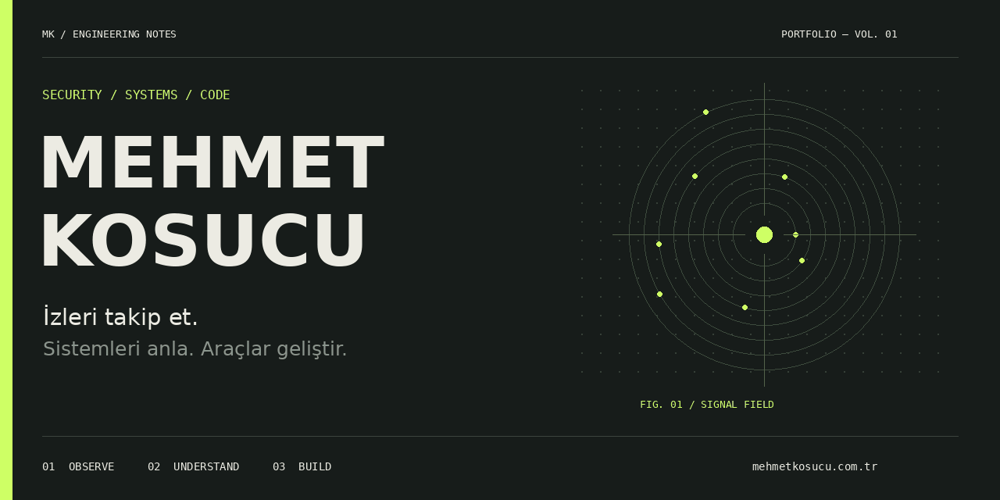
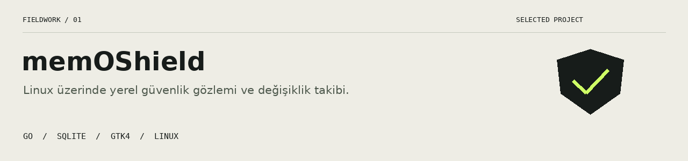
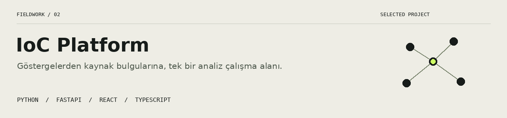

  <a href="https://mehmetkosucu.com.tr"><b>PORTFÖY ↗</b></a>
  &nbsp;&nbsp; / &nbsp;&nbsp;
  <a href="https://github.com/MemoS778?tab=repositories"><b>KOD ARŞİVİ ↗</b></a>
  &nbsp;&nbsp; / &nbsp;&nbsp;
  <a href="#seçilmiş-çalışmalar"><b>SEÇİLMİŞ ÇALIŞMALAR ↓</b></a>

---

### 01 / Çalışma alanım

**Gözlemlenebilir sistemler. İncelenebilir bulgular. Kullanılabilir araçlar.**

Linux güvenlik gözlemi ve tehdit göstergesi analizi üzerine araçlar geliştiriyorum. memOShield ile yerel sistem değişikliklerini görünür kılıyor, IoC Platform ile farklı kaynaklardan gelen bulguları bir analiz çalışma alanında bir araya getiriyorum.

### 02 / Seçilmiş çalışmalar

Portlar, başlangıç girdileri ve seçili dosyalardaki değişiklikleri önceki gözlemlerle karşılaştıran yerel masaüstü uygulaması.

[Kaynak kodunu incele ↗](https://github.com/MemoS778/memOShield)

IP, domain ve dosya hash’leri için kaynak bulgularını karşılaştırma, analist notları ve kalıcı analiz geçmişi. InternetDB, VirusTotal ve AbuseIPDB entegrasyonları.

[Kaynak kodunu incele ↗](https://github.com/MemoS778/IoC-platform)

### 03 / Araç kutusu

| Sistem & masaüstü | Analiz & arayüz |
| :--- | :--- |
| Go · Linux · GTK4 | Python · FastAPI |
| SQLite · Unix sockets | React · TypeScript |

---

<b>Bir sonraki iz, yeni bir fikre dönüşebilir.</b>  <a href="https://mehmetkosucu.com.tr">mehmetkosucu.com.tr ↗</a>

Animasyonsuz kapak / erişilebilir görünüm

